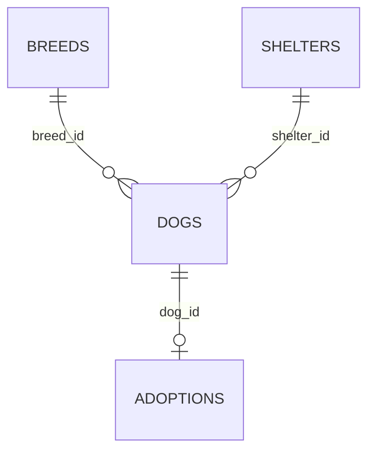
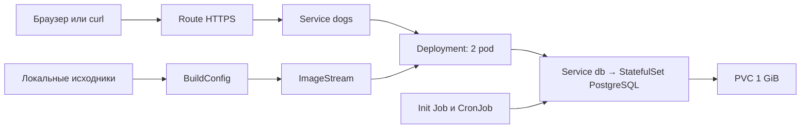

# Добрые лапы — лаборатория OpenShift 🐾

Учебный приют: веб-интерфейс, HTTP API, PostgreSQL и набор ресурсов OpenShift. Работает из терминала Linux / WSL2, графический интерфейс Linux не нужен. Браузер можно открыть в Windows, все действия доступны также через `curl`.

## Два способа запуска

| Режим | Что нужно | Что изучаешь |
|---|---|---|
| Docker Compose в WSL2 / Linux | Docker Engine + Compose v2 | приложение, API, база, контейнеры, тома |
| OpenShift | работающий кластер, `oc`, доступ к проекту | сборки, pods, deployment, route, jobs, PVC, RBAC, сети, масштабирование |

**Compose не устанавливает и не имитирует OpenShift.** Для второго режима подключись из WSL к существующему учебному/удалённому кластеру. Репозиторий содержит приложение для кластера, а не установщик самого кластера.

## Быстрый старт в WSL / Linux

Нужны Bash, Git, Docker Engine и Docker Compose v2 с поддержкой `--wait`. Python на хосте нужен только для дополнительных тестов. Храни проект в `~/dogs-openshift`, а не в `/mnt/c`, чтобы избежать лишних проблем с правами и скоростью.

```bash
git clone <URL-ТВОЕГО-РЕПОЗИТОРИЯ> dogs-openshift
cd dogs-openshift
bash scripts/setup.sh
```

Скрипт создаст `.env` со случайным паролем, соберёт образ, дождётся PostgreSQL, создаст таблицы и демоданные, запустит сервер. Первичная сборка требует интернета. Пароль и данные не попадают в Git.

В браузере **Windows** открой `http://localhost:8080`. Или работай из терминала:

```bash
curl -fsS http://localhost:8080/healthz
curl -fsS http://localhost:8080/readyz
curl -fsS http://localhost:8080/api/dogs
curl -fsS http://localhost:8080/api/info
```

Порт по умолчанию привязан к loopback. Если занят — измени `APP_PORT` в `.env` и снова запусти скрипт. Если localhost из Windows не доступен, сначала проверь `curl` внутри WSL и настройки сети/localhost forwarding WSL.

### Если Docker ещё не установлен

Можно использовать Docker Engine прямо внутри WSL2 без Docker Desktop и без GUI. Установка зависит от дистрибутива: следуй [официальной инструкции Docker Engine для Ubuntu](https://docs.docker.com/engine/install/ubuntu/) или инструкции для своего Linux, включая пакет `docker-compose-plugin`.

Для WSL с systemd после установки:

```bash
sudo systemctl enable --now docker
sudo docker info
sudo usermod -aG docker "$USER"
```

После добавления в группу заново открой сессию; группа `docker` даёт полномочия уровня root. Если systemd отключён, включи его по [инструкции WSL](https://learn.microsoft.com/en-us/windows/wsl/systemd), затем из PowerShell выполни `wsl --shutdown` и снова открой WSL. Альтернатива — уже настроенный Docker Desktop с WSL Integration.

Проверка перед запуском проекта:

```bash
docker info
docker compose version
```

### Управление

```bash
docker compose ps
docker compose logs -f --tail=100 web
docker compose logs init
docker compose exec db psql -U dogs -d dogs
# В psql: \dt, SELECT * FROM dogs; и \q
docker compose down                 # остановка; данные остаются
bash scripts/setup.sh               # повторный запуск / пересборка
# ВНИМАНИЕ: следующая команда удаляет базу с данными:
docker compose down -v
```

После первого запуска не меняй `DB_PASSWORD` в `.env` без смены пароля внутри БД: у образа postgres переменная задаёт пароль при создании нового тома.

## Что внутри приложения



- Породы: список и создание.
- Приюты: название, город, список и создание.
- Собаки: кличка, возраст, порода, приют, статус; создание, список и удаление через API.
- Усыновления: собака, имя хозяина, дата. Создание заявки сразу переводит собаку в `adopted`.

Две одновременные заявки на одну собаку не проходят: транзакция блокирует строку, уникальный ключ дополнительно защищает связь. Удалить собаку с усыновлением нельзя. Повторная инициализация не дублирует демособак.

| Метод | URL | Действие |
|---|---|---|
| GET | `/` | интерфейс |
| GET | `/healthz` | процесс жив, без обращения к БД |
| GET | `/readyz` | база и схема доступны |
| GET | `/api/info` | имя pod, версия, сообщение |
| GET / POST | `/api/breeds` | породы |
| GET / POST | `/api/shelters` | приюты |
| GET / POST | `/api/dogs` | собаки |
| DELETE | `/api/dogs/<id>` | удалить собаку без усыновления |
| GET / POST | `/api/adoptions` | усыновления |

```bash
curl -fsS -X POST http://localhost:8080/api/dogs \
  -H 'Content-Type: application/json' \
  -d '{"name":"Шарик","age":3,"breed_id":1,"shelter_id":1}'

# Возьми dog_id из ответа выше; 4 — пример для свежей базы.
curl -fsS -X POST http://localhost:8080/api/adoptions \
  -H 'Content-Type: application/json' \
  -d '{"dog_id":4,"applicant":"Учебный хозяин"}'
```

Коды: 201 — создано, 400 — неверные данные, 404 — не найдено, 409 — конфликт/нарушение связи, 503 — БД недоступна. Это открытое учебное приложение без авторизации: используй вымышленные данные. Не публикуй его как настоящий сервис приюта без защиты доступа.

## Запуск в OpenShift

Нужен кластер OpenShift 4.x с работающими внутренним registry, BuildConfig/Docker builds, ingress router и StorageClass по умолчанию с динамической выдачей PVC. Нужны права на создание проекта или доступ на запись в существующий. Образы скачиваются из Docker Hub / Quay, Python-пакеты — из PyPI. В изолированном кластере потребуются зеркала. Манифесты рассчитаны на обычные namespace с restricted SCC, `anyuid` не требуется.

Установи совместимый с кластером `oc` по [инструкции Red Hat](https://docs.redhat.com/en/documentation/openshift_container_platform/4.20/html/cli_tools/openshift-cli-oc). Локальный Docker для этого режима не нужен — образ собирается в кластере.

```bash
oc login https://api.ТВОЙ-КЛАСТЕР:6443
# Или используй команду oc login с токеном, выданную администратором.
PROJECT=dogs-lab bash scripts/deploy-openshift.sh
```

Скрипт переключает текущий проект `oc`, создаёт Secret только при его отсутствии, собирает исходники через binary BuildConfig, получает digest образа, поднимает БД, выполняет init Job и разворачивает приложение. Повторный запуск пересобирает образ и сохраняет данные. Если создание проектов запрещено, укажи имя уже выданного проекта через `PROJECT`.

На выходе — HTTPS URL Route. Доверие TLS зависит от сертификата ingress кластера; для локального стенда настрой доверенный CA. Не применяй всю папку через `oc apply -f openshift/`: `DOGS_IMAGE` в app/jobs заменяет скрипт, optional-ресурсы включаются отдельно.



| Ресурс | Где / зачем |
|---|---|
| Project | изоляция лаборатории, создаётся скриптом |
| ImageStream, BuildConfig, Build | хранение метаданных образа, сборка исходников в кластере |
| Deployment, ReplicaSet, Pod | две копии приложения, обновления, самовосстановление |
| StatefulSet | стабильный pod PostgreSQL |
| Service | внутренние адреса приложения и БД |
| Route | внешний HTTPS, TLS termination на роутере |
| ConfigMap | настройки и текст приветствия |
| Secret | пароль БД, генерируется при развёртывании |
| PVC, PV | запрос диска и выделенный кластером том |
| Job | схема и стартовые данные |
| CronJob | каждые пять минут статистика собак в логах |
| ServiceAccount, Role, RoleBinding | отдельный наблюдатель с правами чтения pods/services/logs |
| NetworkPolicy | к БД могут подключаться только приложение и его задания |
| PodDisruptionBudget | минимум одна копия при добровольном выселении |
| HPA, LimitRange, ResourceQuota | опциональные упражнения: CPU-масштабирование и лимиты |

Приложение не использует Kubernetes API, его service account не получает RoleBinding и токен не монтируется. `dogs-observer` нужен для отдельного упражнения с RBAC. Secrets сами по себе не означают шифрование хранилища etcd — это настройка кластера.

Пошаговые упражнения: [docs/labs.md](docs/labs.md).

## Проверки

```bash
python3 -m venv .venv
source .venv/bin/activate
pip install -r requirements.txt
python -m unittest discover -s tests -v
# После запуска Compose: проверяет реальную БД через HTTP, включая гонку усыновлений.
python scripts/smoke.py
# Для OpenShift:
BASE_URL=https://АДРЕС-ROUTE python scripts/smoke.py
```

Smoke-тест оставляет одну тестовую собаку и усыновление, чтобы результат был виден в интерфейсе. Unit-тесты не требуют PostgreSQL. Полный контейнерный запуск и развёртывание в кластер в среде создания проекта не выполнялись: здесь нет работающего Docker daemon и подключения к OpenShift.

## Загрузить в Git

Создай пустой репозиторий на своём Git-сервере, затем из этой папки:

```bash
git init -b main
git add .
git commit -m "Add dogs OpenShift lab"
git remote add origin <URL-ТВОЕГО-РЕПОЗИТОРИЯ>
git push -u origin main
```

`.env`, `.venv`, дампы и кэши исключены через `.gitignore`. Контейнерные тома хранятся вне репозитория. `.gitattributes` сохраняет LF для shell-скриптов. Зависимости приложения закреплены по версиям; базовые образы используют обновляемые теги. Для побитово воспроизводимой сборки дополнительно закрепи digest образов и транзитивные зависимости.

## Структура

```text
app/             Flask API, SQL-схема, интерфейс
openshift/       ресурсы кластера
scripts/         локальный запуск, deploy, HTTP smoke-test
tests/           тесты валидации API
docs/labs.md     практические задания
Dockerfile       образ приложения, порт 8080, непривилегированный UID
compose.yaml     локальные web + PostgreSQL + init
```

Основано на [документации BuildConfig Red Hat](https://docs.redhat.com/en/documentation/openshift_container_platform/4.20/html/builds_using_buildconfig/build-strategies) и [OpenShift-совместимом PostgreSQL SCLorg](https://github.com/sclorg/postgresql-container). В OpenShift используется SCLorg-образ с поддержкой произвольного UID; в Compose — официальный postgres.
